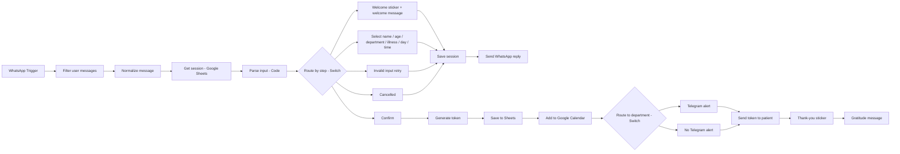

# 🏥 Clinic Appointment Booking Agent

> A WhatsApp-based appointment booking assistant for clinics, built with **n8n**. Patients book through a guided chat, receive a personal token number, and the right department is alerted on Telegram. Every booking is saved to Google Sheets and synced to Google Calendar.


<!-- Add a screenshot of the n8n canvas here:

-->

---

## 📌 Table of Contents

1. [Overview](#-overview)
2. [The Problem](#-the-problem)
3. [The Solution](#-the-solution)
4. [Features](#-features)
5. [Architecture](#-architecture)
6. [Conversation Flow](#-conversation-flow)
7. [Tech Stack](#-tech-stack)
8. [Data Model](#-data-model)
9. [Setup Guide](#-setup-guide)
10. [Configuration](#-configuration)
11. [Usage](#-usage)
12. [Known Limitations](#-known-limitations)
13. [Roadmap](#-roadmap)
14. [Privacy & Compliance](#-privacy--compliance)
15. [License](#-license)

---

## 🌟 Overview

This project is a no-code/low-code automation that turns WhatsApp into a clinic's appointment desk. A patient sends a message, the agent walks them through a few simple questions, and at the end the patient gets a **unique token number**. The matching department receives a Telegram alert, and the booking lands in a spreadsheet and a calendar automatically.

| | |
|---|---|
| **Platform** | n8n (workflow automation) |
| **Patient channel** | WhatsApp Business Cloud API |
| **Department channel** | Telegram |
| **Storage** | Google Sheets |
| **Calendar** | Google Calendar |
| **Departments** | 15 selectable, 5 with Telegram alerts |

---

## ❗ The Problem

Small and mid-sized clinics usually book appointments by phone or at the reception desk. This causes:

- **Missed calls and long waiting times** during busy hours.
- **Manual bookkeeping** in notebooks or scattered spreadsheets, which leads to errors.
- **No clear queue numbers**, so patients and staff are unsure who is next.
- **Slow communication** between reception and the individual departments.
- **Calendars that are out of date**, because bookings are not entered in one place.

---

## ✅ The Solution

The agent automates the full booking journey in one conversation:

| Problem | How this workflow solves it |
|---|---|
| Missed calls | Patients book 24/7 on WhatsApp, an app they already use |
| Manual records | Every booking is written to Google Sheets automatically |
| No queue numbers | A unique token is generated per department, per day |
| Slow department updates | The department gets an instant Telegram message with the patient name and token |
| Scattered schedules | A Google Calendar event is created for each appointment |
| Patient uncertainty | The patient receives a clear confirmation with all details and a thank-you message |

---

## ✨ Features

- 💬 **Guided WhatsApp chat** with a friendly welcome message and step-by-step questions
- 🎨 **Stickers** on the welcome and thank-you messages
- 🏥 **15 departments** to choose from
- 🤒 **Illness selection** from common options, or free-text input
- 📅 **Day and date picker** showing the next 6 open days (Sundays are closed)
- ⏰ **Time slot selection** from 4 slots
- ✅ **Review and confirm screen** before booking
- 🎟️ **Unique token number**, for example `CAR-0211-003`
- 📊 **Google Sheets logging** for sessions and appointments
- 🗓️ **Google Calendar sync** for each confirmed booking
- 📣 **Telegram alerts** with patient name and token for 5 departments
- ✔️ **Staff completion command**: reply `/done TOKEN` in Telegram to mark a patient as attended
- 🙏 **Gratitude message** at the end of every booking
- 🔁 **Restart any time** by typing `menu` or `hi`
- ⚠️ **Input validation** with friendly retry prompts

---

## 🏗️ Architecture



### How state is handled

WhatsApp delivers every message as a separate event, so the workflow has no built-in memory of a conversation. The agent stores each patient's progress in a **`Sessions`** tab in Google Sheets, using the phone number as the key. On every incoming message it:

1. Looks up the patient's current step.
2. Validates the reply for that step.
3. Saves the selection and moves to the next step.

### Staff workflow

A separate branch listens to the departments' Telegram groups with a **Telegram Trigger**. When staff send `/done <TOKEN>`, the appointment status in Google Sheets is updated to `Completed` and the bot confirms in the group.

---

## 💬 Conversation Flow

| Step | Bot asks | Patient replies |
|---|---|---|
| 1 | Welcome message and sticker, then asks for the full name | `Priya Sharma` |
| 2 | Asks for age | `34` |
| 3 | Shows the department list | `2` (for example, Cardiology) |
| 4 | Shows common concerns, or accepts free text | `1` or `Chest discomfort` |
| 5 | Shows the next 6 open days | `3` |
| 6 | Shows the time slots | `1` |
| 7 | Shows a booking summary | `1` to confirm, `2` to cancel |
| 8 | Sends the token, details, thank-you sticker and gratitude message | n/a |

### Token format

```
DEPT-DDMM-NNN        e.g.  CAR-0211-003
```

| Part | Meaning |
|---|---|
| `DEPT` | 3-letter department code |
| `DDMM` | Appointment day and month |
| `NNN` | Running number for that department on that day |

### Departments

General Medicine, Cardiology, Dermatology, Orthopedics, Pediatrics, Gynecology & Obstetrics, ENT, Ophthalmology, Neurology, Gastroenterology, Dentistry, Psychiatry, Urology, Pulmonology, Endocrinology.

Telegram alerts are enabled for **General Medicine, Cardiology, Dermatology, Orthopedics and Pediatrics**. The other departments still receive bookings, but without a Telegram alert.

---

## 🧰 Tech Stack

| Tool | Purpose |
|---|---|
| [n8n](https://n8n.io) | Workflow engine |
| WhatsApp Business Cloud API | Patient conversation (trigger, messages, stickers) |
| Telegram Bot API | Department alerts and staff commands |
| Google Sheets | Session state and appointment records |
| Google Calendar | Appointment scheduling |
| JavaScript (n8n Code node) | Input validation, date logic, token generation |

### n8n nodes used

`WhatsApp Trigger` · `WhatsApp` · `Telegram Trigger` · `Telegram` · `Filter` · `Edit Fields (Set)` · `Switch` · `Code` · `Google Sheets` · `Google Calendar` · `HTTP Request` · `No Operation` · `Sticky Note`

---

## 🗂️ Data Model

Create **one Google Sheet** with two tabs. The header row must match exactly.

### `Sessions`

```
sessionKey | phone | step | name | age | departmentCode | department | illness | day | date | dateLabel | timeSlot | timeStart | timeEnd | updatedAt
```

### `Appointments`

```
token | tokenKey | patientName | age | phone | department | departmentCode | illness | day | date | timeSlot | status | bookedAt | completedAt | completedBy
```

---

## 🚀 Setup Guide

### 1. Prerequisites

- An n8n instance reachable over **public HTTPS** (n8n Cloud or self-hosted). WhatsApp and Telegram need this to deliver messages.
- A Meta developer account with a WhatsApp Business app.
- A Telegram account.
- A Google account.

### 2. WhatsApp Business Cloud API

1. Create an app at [Meta for Developers](https://developers.facebook.com) and add the **WhatsApp** product.
2. Note your **Phone Number ID** and create a **permanent access token**.
3. In n8n, create the credentials for the **WhatsApp Trigger** and **WhatsApp Business Cloud** nodes.
4. Create a **Header Auth** credential for the sticker nodes:
   - Name: `Authorization`
   - Value: `Bearer <your WhatsApp access token>`

### 3. Telegram

1. Create a bot with [@BotFather](https://t.me/BotFather) and copy the token.
2. Add the bot to each department group.
3. Find each group's **chat ID** (for example, with a bot such as `@RawDataBot`, or the Telegram `getUpdates` API).
4. Add the bot credential in n8n.

### 4. Google

1. Create the spreadsheet described in [Data Model](#-data-model).
2. Create **Google Sheets OAuth2** and **Google Calendar OAuth2** credentials in n8n.

### 5. Stickers

Host two public sticker images and note their URLs:

- Format: `.webp`
- Size: 512 × 512 px
- Static stickers should be under 100 KB

### 6. Import and configure

1. In n8n, choose **Import from file** and select `workflow/clinic_appointment_booking_workflow.json`.
2. Replace the placeholders listed below.
3. Select your credentials on each node that shows a warning.
4. Test with a WhatsApp message, then **activate** the workflow.

---

## ⚙️ Configuration

| Placeholder | Where | Replace with |
|---|---|---|
| `YOUR_GOOGLE_SHEET_ID` | All Google Sheets nodes | Your spreadsheet ID |
| `YOUR_CALENDAR_ID` | Add to Google Calendar | Your calendar ID or email |
| `REPLACE_WITH_XXX_CHAT_ID` | The 5 Telegram department nodes | The Telegram group chat IDs |
| `clinicName` | Normalize Message | Your clinic name |
| `timezone` | Normalize Message | An IANA timezone, for example `Asia/Kolkata` |
| `welcomeStickerUrl`, `thanksStickerUrl` | Normalize Message | Your sticker image URLs |

### Customizing

- **Message wording:** edit the text inside the `Select ...` Edit Fields nodes.
- **Departments, concerns, time slots, open days:** edit the lists at the top of the `Parse Input` Code node.
- **Which departments send Telegram alerts:** edit the `Route to Department` Switch and the Telegram nodes.

---

## 📱 Usage

1. A patient sends **hi** to the clinic's WhatsApp number.
2. They answer the questions and confirm the booking.
3. The patient receives the token and details.
4. The department receives a Telegram alert, for example:

   ```
   🏥 New Appointment — Cardiology

   🎟 Token: CAR-0211-003
   👤 Patient: Priya Sharma
   📅 Monday, 02 Nov 2026
   ⏰ Morning 09:00 AM - 11:00 AM

   Reply /done CAR-0211-003 once the patient has been attended.
   ```

5. Staff reply `/done CAR-0211-003` when the patient has been seen.

---

## ⚠️ Known Limitations

- **Slot capacity is not enforced.** Several patients can book the same time slot.
- **Token collisions are possible** if two patients confirm for the same department at the same second.
- **No reschedule or cancel** after a booking is confirmed. Only the cancel option on the confirm screen exists.
- **One message at a time.** If WhatsApp delivers several messages in a single event, only the first is processed.
- **WhatsApp 24-hour rule.** Free-form replies work only within 24 hours of the patient's last message.
- **Text replies only.** Voice notes, images and other message types are treated as invalid input.
- **`/done` can be sent by anyone in the department group.**

---

## 🛣️ Roadmap

- [ ] Slot capacity limits and double-booking prevention
- [ ] Reschedule and cancel commands
- [ ] Reminder messages before the appointment
- [ ] Doctor selection within a department
- [ ] Multi-language support
- [ ] Payment link integration
- [ ] Dashboard for daily queue and statistics

---

## 🔒 Privacy & Compliance

This workflow handles **personal and health-related information**.

- Patient details are stored in Google Sheets. Restrict access to that spreadsheet to authorized staff only.
- Telegram alerts contain only the patient's name, token, date and time slot. They do not include the illness or age.
- Obtain patient consent and follow the data-protection and healthcare privacy laws that apply in your region.
- Never commit credentials, access tokens or real chat IDs to this repository.

---

## 📄 License

Released under the [MIT License](LICENSE). Replace this section if you choose a different license.

---

## 🙌 Acknowledgements

Built with [n8n](https://n8n.io). Contributions, issues and feature requests are welcome.
